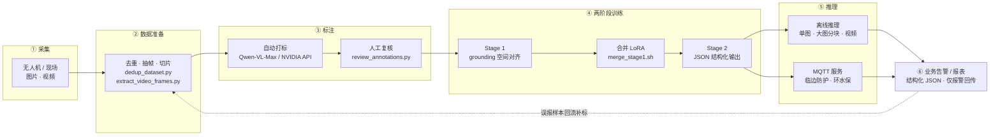

<div align="center">

# Qwen-VL 工程安全视觉微调

**面向工程安全场景（临边防护 / 基坑围挡 · 水域 · 交通导改）的 Qwen-VL 视觉微调工程：自动标注 → 人工复核 → 两阶段 LoRA 训练 → 合并 → 离线 / MQTT 推理 → 业务告警**

[](https://github.com/QwenLM/Qwen3-VL)
[](#5-两阶段训练详解)
[](https://github.com/modelscope/ms-swift)
[](requirements.txt)
[](#61-环境安装)
[](#66-mqtt-服务化推理)
[](#61-环境安装)
[-9cf?style=flat-square)](#4-仓库结构)

</div>

> 一句话：把通用 Qwen-VL 训练成"**能看见隐患、能框出位置、能吐出业务可用 JSON**"的工程安全巡检模型，并接进 MQTT 告警链路。
>
> 数据规模、任务与指标的权威口径见 [VLM_progress_report.md](VLM_progress_report.md)；开发约定见 [CLAUDE.md](CLAUDE.md)。

---

## 目录

- [1. 项目在做什么](#1-项目在做什么)
- [2. 核心特性](#2-核心特性)
- [3. 系统流程](#3-系统流程)
- [4. 仓库结构](#4-仓库结构)
- [5. 两阶段训练详解](#5-两阶段训练详解)
- [6. 快速开始](#6-快速开始)
- [7. 关键脚本一览](#7-关键脚本一览)
- [8. 超参数与调优](#8-超参数与调优)
- [9. 输出契约](#9-输出契约)
- [10. 文档索引](#10-文档索引)
- [11. 已知限制](#11-已知限制)
- [12. Roadmap](#12-roadmap)

---

## 1. 项目在做什么

### 1.1 场景

施工现场的"临边防护缺失/围栏断口/围栏倒伏"这类隐患，不是简单的"图里有没有围栏"：

- 需要理解"**围栏是否合围**""平台间隙是否安全"这类**强逻辑关联**关系；
- 无人机高空俯拍下，护栏往往只占几百像素，属于**小目标**；
- 未微调的通用 VLM 会产生幻觉——文字推理说"这里有断口"，最终 JSON 却输出 `violation_detected: false`，或者对小断口"视而不见"。

这三点决定了项目选择 **VLM + 领域微调**，而不是纯目标检测（YOLO 只能回答"这里有个围栏"，回答不了"是否合围"），详见 [微调实践分享](docs/archive/Qwen-VL_Finetuning_Presentation.md)。

### 1.2 场景矩阵

| 业务线 | 代码目录 | 任务定义 | 训练方式 | 当前状态 |
| --- | --- | --- | --- | --- |
| **临边防护缺失**（主线） | `scripts/qwen3.5-edge/`、`scripts/2_stage_train-qwen-vl/` | 判断是否存在临边防护缺失，并给出 0–1000 坐标框 + severity + suggestion | **两阶段**（Stage 1 grounding → Stage 2 JSON） | 已跑通训练/合并/推理，已接 MQTT |
| **环水保**（水体污染） | `scripts/qwen3.5-water/` | 判断水体 `normal / polluted`，给出一句话描述，不输出框 | **单阶段**（LoRA + bf16） | 已完成微调，已接 MQTT（仅报警回传） |
| **交通导改** | `scripts/qwen3.5-traffic/` | 标志标牌遮挡、锥桶缺失移位等导改安全隐患 | 方案稿（复用两阶段路线，暂无代码） | 规划中 |
| 早期通用边防护 | `scripts/archive/` | Qwen2.5-VL-7B 时代的通用边防护识别、LabelMe 流程 | QLoRA 单阶段 | **已归档**，只读参考 |

### 1.3 任务边界（重要约定）

模型不是开放式问答，而是**结构化监测模块**：

- 输出**纯 JSON**（不带思维链、不带 Markdown 代码块），方便下游系统直接解析；
- 框坐标统一使用 **0–1000 千分比相对坐标** `[x_min, y_min, x_max, y_max]`；
- 标签一致性硬约束：`violation_detected=false → violation_boxes: []`，`true → 非空`；
- **边坡坡面 ≠ 违规**：坡面本体不需要围挡，只有真正危险临边才需要；
- 证据不足时输出 `uncertain`，宁可保守，不强行判断。

---

## 2. 核心特性

- **两阶段训练（Grounding → JSON）**：先教模型"看哪里、框哪里"，再教它"怎么用标准 JSON 表达"，避免把定位与格式混在一起训。支持 **bf16 普通 LoRA**（当前主线）与 **4-bit QLoRA**（低显存备选）两种配置。
- **自动标注流水线**：DashScope `Qwen-VL-Max` / NVIDIA API 批量打标，产出 canonical annotation 缓存，**断点续传**，失败/低置信度自动落 `annotate_skip.json`，并可 `--derive-only` 离线重新派生 JSONL。
- **人工复核 Web UI**：Flask + Canvas 叠加，鼠标拖拽补框、改标签、删框、整体判合规、低置信度优先排序，审查结果回写缓存后再派生训练数据。
- **数据清洗**：MD5 精确去重 + pHash 感知去重；视频按 fps 抽帧并对相邻帧做 pHash 去重；支持导出 **Label Studio** 格式做第三方标注。
- **大图分块（tiled）**：训练侧用 `gen_tiled_stage1.py` 生成 2×2 分块 grounding 样本；推理侧 `tiled_infer.py` 全图 + 2×2 滑窗双路推理，IoU 合并去重，专治 DJI 4032×3024 大图上的小目标。
- **视频流推理降误报**：帧差抽帧（画面不变就复用上一帧结论）+ 多帧滑窗投票（>50% 才告警），显著抑制无人机视角晃动导致的单帧误报。
- **MQTT 服务化**：临边防护（`jiahe/frame/+` → `jiahe/alertsNonRealtime/{stream_id}`）与环水保（`water/detect/request` → `water/detect/result`）两套 Topic，支持 OSD 位置缓存、画框图回传、仅报警回传；附一键启停脚本。
- **可复现的环境自检**：`test_qwen3.5_env.sh` 一条命令检查 torch/CUDA、torchvision nms、transformers、peft、swift、causal_conv1d。
- **可迭代的数据飞轮**：误报图回收 → 补标合规负样本 → 重训一轮，形成闭环。

---

## 3. 系统流程



---

## 4. 仓库结构

```text
qwen_fine_tuning/
├── dataset/                     # ✅ 已入库：540 个文件（270 组 图片 + LabelMe JSON，约 665MB）
│   ├── 1-100/                   #   早期人工分批标注图片
│   ├── 221-330/
│   ├── 标注111-220/
│   ├── 北二绕无人机图片标注/     #   无人机实拍批次
│   └── 无人机图片标识441-550(1)/
├── data/                        # ✅ 已入库：训练/评测 JSONL、打标缓存、分块子图（143 个文件）
│   ├── unique_images.txt        #   去重后的图片清单（当前 814 行）
│   ├── annotate_cache.json      #   canonical annotation（Qwen-VL-Max 打标 + 人工复核，断点续传）
│   ├── annotate_skip_nvidia.json#   NVIDIA 流水线的失败/跳过记录
│   ├── stage1_grounding.jsonl   #   Stage 1 训练数据（仓库快照 296 条）
│   ├── stage2_json.jsonl        #   Stage 2 训练数据（仓库快照 699 条）
│   ├── test.jsonl               #   离线评估测试集（15 条）
│   ├── tiled_crops/             #   大图切出的 1024 分块（104 张）
│   └── archive/                 #   旧格式数据快照（只读参考）
├── test/                        # ✅ 已入库：抽检图片 37 张
├── scripts/
│   ├── 2_stage_train-qwen-vl/   # 两阶段训练流水线：去重 / 打标 / 复核 / 训练 / 合并 / 评估
│   ├── qwen3.5-edge/            # 【当前主线】Qwen3.5-2B 临边防护缺失：两阶段训练 + 视频/MQTT 推理
│   ├── qwen3.5-water/           # 环水保：水体污染检测（单阶段 + MQTT）
│   ├── qwen3.5-traffic/         # 交通导改识别（方案稿）
│   ├── archive/                 # 旧流程脚本：LabelMe、旧训练、旧数据准备、旧 dedup 工作区
│   ├── chat.py                  # 交互式推理入口（自动大图分块）
│   ├── inference.py             # 单图 / 批量推理
│   ├── eval.py                  # 测试集离线评估
│   ├── tiled_infer.py           # 大图分块推理核心
│   ├── model_utils.py           # Qwen2.5-VL / Qwen3-VL 统一加载与推理
│   └── prompts.py               # 系统提示词与配置常量
├── docs/
│   ├── PRD_two_stage_training.md          # 两阶段方案 PRD（数据流 / 格式 / 参数）
│   ├── hyperparameters_and_optimization.md# 视频推理超参与降误报策略
│   └── archive/                           # 旧 PRD、汇报分享稿
├── archive/                     # 项目级归档：早期手测样图与临时脚本
├── CLAUDE.md                    # ⭐ 开发约定：标签/坐标/环境/常见陷阱
├── README.md                    # 本文件
├── VLM_progress_report.md       # ⭐ 阶段性进展汇报（对外口径与数据规模）
├── MQTT测试接口文档.md           # 环水保 MQTT 联调接口说明
├── MQTT测试用例.md               # MQTT 联调用例
├── requirements.txt             # 完整 pip freeze（含 Linux wheel 直链）
├── requirements_minimal.txt     # 最小依赖清单
├── start_mqtt_services.sh       # 一键启动两套 MQTT 推理服务
├── stop_mqtt_services.sh        # 一键停止
├── test_qwen3.5_env.sh          # 环境自检
└── test_qwen3.5_env.log         # 环境自检历史日志
```

### 未入库内容（体积 / 安全原因）

| 内容 | 体积 | 说明 |
| --- | --- | --- |
| `models/` | ~4.3GB | Qwen3.5-2B 等基础模型权重，请自行从 HuggingFace / ModelScope 下载 |
| `outputs/` | ~4.8GB | 训练 checkpoint、合并模型、评估与可视化结果 |
| `wheels/` | ~827MB | `flash-attn` / `causal-conv1d` 预编译 wheel 与 `libcudart.so.12` |
| `test-26-07-15/` | ~206MB | 一次性测试视频/图片目录 |
| `llama-qwen_full_20260625.zip` | ~4.5GB | 项目整包备份 |
| `libcudart.so.12` | 0.7MB | CUDA 运行时二进制（部署机补丁，单独分发） |
| `__pycache__/` | — | Python 字节码缓存 |

> `docs/Qwen模型二阶段训练开发记录.pdf` 因企业 DLP 加密且含内网标识，未纳入本仓库；如需公开请另行提供脱敏版本。

**克隆建议**：仓库约 715MB，主要是 `dataset/` 与 `data/`。只想要代码/文档时用 partial clone（实测 10 秒内完成）：

```bash
git clone --filter=blob:none --sparse https://github.com/SolitudeZY/qwen_fine_tuning.git
cd qwen_fine_tuning
git sparse-checkout set scripts docs        # 根目录文件默认保留
```

需要完整图片数据时再执行 `git sparse-checkout disable`（会下载全部 blob）。

---

## 5. 两阶段训练详解

### 5.1 为什么分两阶段

一次性把"识别 + 定位 + JSON 格式"混在一起训，小样本（数百条）下极易出现两个问题：**定位偏**、**格式漂移/重复生成**。拆成两阶段后：

1. **Stage 1（grounding）**：先建立视觉–空间对齐能力，让模型学会"看到哪里 → 输出那里的坐标"；
2. **Stage 2（JSON）**：在已对齐的模型上，只学"如何稳定输出业务 JSON"（`violation_detected / violation_type / severity / suggestion / violation_boxes`）。

> 若下游任务不需要画框、不需要定位，可以跳过 Stage 1 只做单阶段训练（环水保项目即如此）。

### 5.2 Stage 1：Grounding 空间对齐

**目标**：让模型对"临边防护缺失区域"给出正确的 0–1000 坐标框。

**输入/输出格式**（ms-swift 多模态对话 + `objects` 字段，坐标 `norm1000`）：

```json
{
  "messages": [
    {"role": "user", "content": "<image>请找出图中所有临边防护缺失的位置"},
    {"role": "assistant", "content": "<ref-object><bbox>"}
  ],
  "images": ["/abs/path/to/image.jpg"],
  "objects": {
    "ref": ["临边防护缺失"],
    "bbox": [[488, 180, 743, 294]],
    "bbox_type": "norm1000"
  }
}
```

**关键脚本与真实命令**（`scripts/qwen3.5-edge/train_stage1.sh`，当前主线配置）：

```bash
bash scripts/qwen3.5-edge/train_stage1.sh
# 脚本内会先 conda activate qwen35-ft，并检查 data/stage1_grounding.jsonl 是否存在
```

```bash
swift sft \
    --model  /home/fs-ai/llama-qwen/models/Qwen/Qwen3.5-2B \
    --model_type qwen3_5 \
    --tuner_type lora \
    --dataset /home/fs-ai/llama-qwen/data/stage1_grounding.jsonl \
    --split_dataset_ratio 0.05 \
    --torch_dtype bfloat16 \
    --output_dir /home/fs-ai/llama-qwen/outputs/stage1_grounding/qwen3.5 \
    --num_train_epochs 5 \
    --per_device_train_batch_size 2 \
    --gradient_accumulation_steps 2 \
    --learning_rate 1e-4 \
    --lora_rank 8 --lora_alpha 32 --lora_dropout 0.05 \
    --target_modules all-linear \
    --freeze_vit false \
    --group_by_length true \
    --gradient_checkpointing true \
    --add_non_thinking_prefix true \
    --loss_scale ignore_empty_think \
    --max_length 2048 \
    --save_strategy steps --save_steps 100 --save_total_limit 3 \
    --eval_strategy steps --eval_steps 100 \
    --metric_for_best_model eval_loss --load_best_model_at_end true \
    --attn_impl flash_attention_2 \
    --use_liger_kernel true
```

几个不显然的取舍（脚本注释里写明）：

- **不用 QLoRA**：Qwen3.5 的 linear_attention / Mamba 层不适合 4bit 量化，改用「普通 LoRA + bf16」，2B 模型单卡 24GB 足够；
- **`--group_by_length true`**：transformers 后端的 GatedDeltaNet 不支持 packing/padding_free，用它平衡负载、减少 padding；
- **`--target_modules all-linear`**：自动注入所有 `nn.Linear`（含 ViT、full_attention、MLP），跳过 conv1d；
- **`--add_non_thinking_prefix` + `--loss_scale ignore_empty_think`**：Qwen3.5 是混合思考模型，定位任务不需要思考链，显式关闭 thinking。

**产物**：`outputs/stage1_grounding/qwen3.5/vN-<时间戳>/checkpoint-*` 与 `train.log`。

### 5.3 合并 Stage 1 LoRA

`scripts/qwen3.5-edge/merge_stage1.sh`：先调 `find_best_ckpt.py` 自动选最优 checkpoint（优先 `trainer_state.json` 的 `best_model_checkpoint`，退化到 `eval_loss` 最小、再退化到最新步数），再 `swift export` 合并：

```bash
bash scripts/qwen3.5-edge/merge_stage1.sh
# 或手动指定 checkpoint
bash scripts/qwen3.5-edge/merge_stage1.sh /path/to/v13-xxxx/checkpoint-150
```

```bash
swift export \
    --model /home/fs-ai/llama-qwen/models/Qwen/Qwen3.5-2B \
    --model_type qwen3_5 \
    --adapters <checkpoint_path> \
    --merge_lora true \
    --torch_dtype bfloat16 \
    --output_dir /home/fs-ai/llama-qwen/outputs/stage1_merged/qwen3.5/merged-<timestamp>
```

> 注意：`swift export` 要求 `--output_dir` **不能已存在**，脚本已自动加时间戳；合并后目录名是 `merged-YYYYmmdd-HHMMSS`。

### 5.4 Stage 2：JSON 结构化输出

**目标**：基于 Stage 1 合并模型，稳定输出纯 JSON（含定位框），不再学习"怎么找"。

**输入/输出格式**：与 Stage 1 相同的多模态对话，但 assistant 内容是纯 JSON 字符串（不带推理文本、不带代码块）：

```json
{
  "violation_detected": true,
  "violation_type": "临边防护缺失",
  "severity": "中",
  "suggestion": "请立即在临边设置连续围栏或防护网，并补齐警示标识。",
  "violation_boxes": [
    {"label": "临边防护缺失", "bbox": [488, 180, 743, 294]}
  ]
}
```

**真实命令**（`scripts/qwen3.5-edge/train_stage2.sh`，自动选最新合并模型）：

```bash
bash scripts/qwen3.5-edge/train_stage2.sh                    # 自动取 outputs/stage1_merged/qwen3.5/merged-* 最新
bash scripts/qwen3.5-edge/train_stage2.sh <merged_model_dir> # 手动指定基座
```

```bash
swift sft \
    --model <stage1_merged_dir> \
    --model_type qwen3_5 --tuner_type lora \
    --dataset /home/fs-ai/llama-qwen/data/stage2_json.jsonl \
    --torch_dtype bfloat16 \
    --output_dir /home/fs-ai/llama-qwen/outputs/stage2_json/qwen3.5 \
    --num_train_epochs 5 \
    --per_device_train_batch_size 2 --gradient_accumulation_steps 2 \
    --learning_rate 5e-5 \
    --lora_rank 8 --lora_alpha 32 --lora_dropout 0.05 \
    --target_modules all-linear --freeze_vit false \
    --add_non_thinking_prefix true --loss_scale ignore_empty_think \
    --max_length 4096 \
    --attn_impl flash_attention_2 --use_liger_kernel true
```

与 Stage 1 的差异：`max_length 2048 → 4096`（system prompt + JSON 更长）、`lr 1e-4 → 5e-5`（避免破坏已学到的定位能力）、`epochs 5`（脚本注释：Stage 2 数据量更大，轮数适当控制）。

### 5.5 两套训练配置对照

| 项 | **A. bf16 普通 LoRA**（`scripts/qwen3.5-edge/`，当前主线） | **B. 4-bit QLoRA**（`scripts/2_stage_train-qwen-vl/`） |
| --- | --- | --- |
| 基座 | Qwen3.5-2B | Qwen3.5-2B（脚本内 `MODEL_DIR`） |
| 量化 | 不量化（bf16） | bnb 4bit，nf4 |
| 训练入口 | `train_stage1.sh` → `merge_stage1.sh` → `train_stage2.sh` | 同左（文件名相同） |
| LoRA | rank 8 / alpha 32 / dropout 0.05 / all-linear | rank 32 / alpha 64 / dropout 0.05 |
| Stage 1 | lr 1e-4, epochs 5, bs 2 × accum 2, `IMAGE_MAX_TOKEN_NUM=1024` | lr 3e-5, epochs 6, bs 2 × accum 2, `MAX_PIXELS=1048576` |
| Stage 2 | lr 5e-5, epochs 5, `max_length=4096` | lr 5e-5, epochs 15, bs 1 × accum 8, `MAX_PIXELS=1505280` |
| conda 环境 | `qwen35-ft`（Stage 2 脚本用 `qwen35-ft-rollback`） | `qwen-ft` |
| 适用 | 单卡 24GB / 追求最新 Qwen3.5 能力 | 显存更紧、或复用早期 Qwen3-VL 数据流水线 |

### 5.6 训练后验证

```bash
# 从人工复核过的 cache 抽样评估：Precision / Recall / Accuracy / 混淆矩阵 / 平均耗时
python scripts/qwen3.5-edge/test_from_cache_qwen35.py \
    --model-path outputs/stage1_merged/qwen3.5/merged-xxxx \
    --lora-path  outputs/stage2_json/qwen3.5/vN-xxxx/checkpoint-xxx \
    --sample-size 50 --reviewed-only

# 单图交互式推理 + 画框可视化
python scripts/qwen3.5-edge/chat_qwen35.py \
    --model-path outputs/stage1_merged/qwen3.5/merged-xxxx \
    --lora-path  outputs/stage2_json/qwen3.5/vN-xxxx/checkpoint-xxx \
    --image /path/to/img.jpg --visualize
```

---

## 6. 快速开始

> 下方命令中的 `/home/fs-ai/llama-qwen` 是训练服务器上的项目根目录（脚本内硬编码 `PROJECT_ROOT`）。在别的机器上复现时，请同步改脚本里的 `PROJECT_ROOT` 和 conda 环境名。仓库目录名与服务器目录名不同（`qwen_fine_tuning` vs `llama-qwen`），路径按你的实际部署调整。

### 6.1 环境安装

```bash
# 1) 创建环境（Python 3.12）
conda create -n qwen35-ft python=3.12 -y && conda activate qwen35-ft

# 2) 安装 CUDA 12.8 版 PyTorch（sm_120 / RTX 50 系必需）
pip install torch==2.11.0 torchvision==0.26.0 torchaudio==2.11.0 \
    --index-url https://download.pytorch.org/whl/cu128

# 3) 安装其余依赖（最小集合，含 ms-swift / peft / qwen-vl-utils / paho-mqtt / Flask）
pip install -r requirements_minimal.txt

# 4) 自检（torch+cuda、torchvision nms、transformers、peft、swift、causal_conv1d）
bash test_qwen3.5_env.sh
```

需要完整环境快照时用 `requirements.txt`（注意里面含服务器本地 wheel 的 `file://` 直链，需自行替换）。

**flash-attn / causal-conv1d 注意**（详见 [CLAUDE.md](CLAUDE.md)）：

- 训练脚本使用 `--attn_impl flash_attention_2`；flash-attn 与 torch/CUDA 版本强绑定，优先用预编译 wheel（当前 2.8.3），不要混用 cu128 / cu130；
- 本机只有 32G 内存，**编译 CUDA 扩展时严禁并发**：`MAX_JOBS=1`、`OMP_NUM_THREADS=1`（已有安全脚本 `scripts/qwen3.5-edge/build_flash_attn_safe.sh`）；
- 在 `sm_120`（RTX 5060 Ti）上做推理时，flash-attn 可能触发 illegal memory access，**推理基线用 `sdpa`**；实测 `torch 2.11.0+cu128 + sdpa` 约 3.9–4.0 s/张，而 `torch 2.9.1+cu128 + sdpa` 约 17–20 s/张——做速度对比必须同时记录 torch/transformers/peft 版本与 `attn_impl`。

### 6.2 数据准备

```bash
# 图片去重（MD5 精确 + pHash 感知），生成 data/unique_images.txt 与去重报告
python scripts/2_stage_train-qwen-vl/dedup_dataset.py

# 可选：视频抽帧（默认 1 FPS + 相邻帧 pHash 去重，--tile 同时切 1080×1080）
python scripts/2_stage_train-qwen-vl/extract_video_frames.py --fps 1 --tile

# 可选：按子目录增量拼装图片清单（跨目录 pHash 去重，不动全量扫描结果）
python scripts/2_stage_train-qwen-vl/build_unique_list.py
```

### 6.3 自动标注 + 人工复核

```bash
export DASHSCOPE_API_KEY=your_key

# 1) Qwen-VL-Max 批量打标：写 cache（断点续传），并派生 stage1_grounding.jsonl + stage2_json.jsonl
python scripts/2_stage_train-qwen-vl/api_annotate_stage12.py
#    备选：NVIDIA API 流水线（产物带 _nvidia 后缀）
# python scripts/2_stage_train-qwen-vl/api_annotate_nvidia.py --model <vision-model>

# 2) 人工复核（Flask Web UI，默认 5001 端口）
python scripts/2_stage_train-qwen-vl/review_annotations.py
#    远程机器通过 SSH 端口转发访问：
#    ssh -L 5001:localhost:5001 user@server   →   浏览器打开 http://localhost:5001

# 3) 审查完不重新调 API，直接从 cache 重新派生训练数据
python scripts/2_stage_train-qwen-vl/api_annotate_stage12.py --derive-only

# 4) 可选：清理越界 / 反向 / 过小 bbox
python scripts/2_stage_train-qwen-vl/fix_cache_bbox.py

# 5) 可选：导出 Label Studio 格式做外部标注
python scripts/2_stage_train-qwen-vl/export_to_labelstudio.py --out export/labelstudio --only all
```

> ⚠️ Stage 2 数据**不要混入 grounding 格式样本**（含 `<ref-object><bbox>`），否则模型会出现"重复生成"的格式 bug。

### 6.4 训练 + 合并（两阶段）

```bash
# Stage 1：grounding 空间对齐
bash scripts/qwen3.5-edge/train_stage1.sh

# 合并 LoRA（自动挑最优 checkpoint，输出 merged-<时间戳>）
bash scripts/qwen3.5-edge/merge_stage1.sh

# Stage 2：JSON 结构化输出（自动取最新 merged 模型，或手动传路径）
bash scripts/qwen3.5-edge/train_stage2.sh
```

训练日志分别在 `outputs/stage1_grounding/qwen3.5/train.log`、`outputs/stage2_json/qwen3.5/train.log`。

### 6.5 推理与评估

```bash
# 交互式 / 单图推理（>4,000,000 像素的 DJI 大图自动双路：全图 + 2×2 分块）
python scripts/chat.py --image /path/to/img.jpg \
    --lora_path outputs/stage2_json/vN/checkpoint-X --visualize

# 强制分块推理
python scripts/chat.py --image /path/to/img.jpg --tiled --visualize

# 批量目录推理 → JSON
python scripts/inference.py --image_dir /path/to/dir --lora_path outputs/stage2_json/vN/checkpoint-X \
    --output outputs/inference_results.json

# 两阶段模型评估（Recall / Precision / IoU，支持 --tiled / --base-only / --count）
python scripts/2_stage_train-qwen-vl/test_v2.py --count 30

# 视频推理：帧差抽帧 + 滑窗投票 + 画框报告
python scripts/qwen3.5-edge/video_infer_qwen35.py \
    --video /path/to/video.mp4 \
    --model-path outputs/stage1_merged/qwen3.5/merged-xxxx \
    --lora-path  outputs/stage2_json/qwen3.5/vN/checkpoint-xxx \
    --fps 1.0 --diff-threshold 25.0 --window-size 5 --visualize
```

### 6.6 MQTT 服务化推理

一键启停（同时拉起环水保 + 临边防护两套 2B 服务，约需 10GB+ 显存）：

```bash
# 启动：自动准备 LD_LIBRARY_PATH（conda lib + wheels/ 下的 libcudart.so.12 补丁）
export PROJECT_ROOT=/home/fs-ai/jiahe/Qwen-3.5      # 部署机项目根目录（默认值见脚本）
export CONDA_ENV=qwen35
bash start_mqtt_services.sh

# 查看日志
tail -f $PROJECT_ROOT/logs/mqtt_water.log
tail -f $PROJECT_ROOT/logs/mqtt_edge.log

# 停止
bash stop_mqtt_services.sh
```

也可以直接单独启动某个服务：

```bash
# 临边防护：jiahe/frame/+  →  jiahe/alertsNonRealtime/{stream_id}
python scripts/qwen3.5-edge/video_infer_qwen35.py \
    --mqtt-serve --mqtt-publish-mode immediate \
    --model-path outputs/stage1_merged/qwen3.5/merged-xxxx \
    --lora-path  outputs/stage2_json/qwen3.5/vN/checkpoint-xxx

# 环水保：water/detect/request  →  water/detect/result（仅 polluted 回传）
python scripts/qwen3.5-water/04_mqtt_inference.py \
    --model-path models/Qwen/Qwen3.5-2B \
    --lora-path  outputs/qwen3.5-water/train/v1-xxxx/checkpoint-xxx \
    --mqtt-serve
```

| 服务 | 请求 Topic | 结果 Topic | 位置信息 | 回传策略 |
| --- | --- | --- | --- | --- |
| 临边防护 | `jiahe/frame/+` | `jiahe/alertsNonRealtime/{stream_id}` | 订阅 `thing/product/+/osd`，按 `stream_id == data.sn` 命中缓存 | `immediate` 或 `flush` 批量 |
| 环水保 | `water/detect/request` | `water/detect/result` | 同上（OSD 缓存） | **仅 `polluted` 回传**，`normal` 静默 |

默认 Broker：`218.3.126.49:1883`（以服务端启动参数 `--mqtt-broker/--mqtt-port` 为准）。

联调步骤（环水保）：先订阅 `water/detect/result` → 发 OSD 消息 → 等 1–2 秒 → 发图片请求（`img` 为 Base64）→ 污染图应有 `success=true` 结果，正常图收不到结果是**符合预期**的。字段级细节见 [MQTT测试接口文档.md](MQTT测试接口文档.md)，现成测试脚本：

```bash
python scripts/qwen3.5-water/test_mqtt.py --mode water
```

### 6.7 误报回流（数据飞轮）

1. 从 `alert_frames/` 或推理输出里挑出误报图（远景合规护栏被画框的截图）；
2. 换成无框原图，标为"合规"（`violation_detected=false`，`violation_boxes=[]`）；
3. 加入 `data/` 重新派生 JSONL，再训 1 个 epoch；
4. 复测 `test_from_cache_qwen35.py`，确认 Precision 未回退。

---

## 7. 关键脚本一览

### 7.1 根目录脚本（`scripts/`）

| 脚本 | 作用 |
| --- | --- |
| `scripts/chat.py` | 交互式/单图推理入口：支持 LoRA 挂载、`--tiled` 大图分块、`--visualize` 画框输出；>4,000,000 像素自动启用全图 + 2×2 双路推理 |
| `scripts/inference.py` | 单图 / 目录批量推理，结果写 JSON；支持 Qwen2.5-VL 与 Qwen3-VL |
| `scripts/eval.py` | 基于 `data/test.jsonl` 的离线评估，统计违规判定与违规类型准确率 |
| `scripts/tiled_infer.py` | 大图滑动窗口推理核心：2×2 重叠子图分别推理，坐标映射回原图 + IoU 去重合并；被 `chat.py` 调用 |
| `scripts/model_utils.py` | `load_vlm()` / `infer_vlm()` 统一模型加载与推理，按模型族切换实现 |
| `scripts/prompts.py` | 系统提示词、查询模板、测试目录配置常量（`chat.py` 等共享） |

### 7.2 两阶段训练流水线（`scripts/2_stage_train-qwen-vl/`）

| 脚本 | 作用 |
| --- | --- |
| `dedup_dataset.py` | 图片去重：MD5 精确去重 + pHash 感知去重，输出 `data/unique_images.txt` 与去重报告 |
| `extract_video_frames.py` | 无人机视频抽帧：按 fps 抽帧 + 相邻帧 pHash 去重，`--tile` 可选切 1080×1080 |
| `build_unique_list.py` | 按子目录增量构建图片清单，跨目录 pHash 去重（不动全量扫描结果） |
| `api_annotate_stage12.py` | Qwen-VL-Max 批量打标 → canonical cache → 派生 Stage 1/2 JSONL；断点续传，`--derive-only` / `--dry-run` / `--threshold` |
| `api_annotate_nvidia.py` | 同流程的 NVIDIA API 备选实现（产物带 `_nvidia` 后缀） |
| `review_annotations.py` | 人工审查 Web UI（Flask + Canvas）：拖拽补框、改标签、删框、判合规、低置信度优先排序，结果回写 cache |
| `fix_cache_bbox.py` | 离线清洗 cache 中越界 bbox：clamp 0–1000、修正 x0>x1、过滤边长 <10 的碎框 |
| `gen_tiled_stage1.py` | 为大图生成 2×2 / 20% 重叠的分块 grounding 样本，bbox 转块内坐标（对齐分块推理） |
| `export_to_labelstudio.py` | 把人工审查后的标注导出为 Label Studio Import JSON（含 images/ 与 manifest） |
| `train_stage1.sh` | Stage 1 grounding 训练（4-bit QLoRA 配置，swift sft） |
| `merge_stage1.sh` | Stage 1 LoRA 合并（自动找最新 checkpoint，`swift export --merge_lora true`） |
| `train_stage2.sh` | Stage 2 JSON 精调（基于 Stage 1 合并模型，支持 `--resume` 续训） |
| `test_v2.py` | 两阶段模型评估：Recall / Precision / 平均 IoU，`--tiled` / `--base-only` / `--count` |
| `README.md` | 该流程的完整使用指南（含常见问题） |

### 7.3 当前主线（`scripts/qwen3.5-edge/`）

| 脚本 | 作用 |
| --- | --- |
| `train_stage1.sh` | Qwen3.5-2B grounding 训练：普通 LoRA + bf16、`all-linear`、flash_attention_2、liger kernel |
| `merge_stage1.sh` | 调 `find_best_ckpt.py` 选最优 checkpoint 后 `swift export` 合并，输出 `merged-<时间戳>` |
| `train_stage2.sh` | Stage 2 JSON 精调：自动取最新 merged 模型，`max_length=4096`，lr 减半 |
| `find_best_ckpt.py` | 最佳 checkpoint 自动寻优：`best_model_checkpoint` → 最小 `eval_loss` → 最新步数 |
| `chat_qwen35.py` | Qwen3.5 专用推理：单图/交互、LoRA 挂载、`--visualize` 画框、默认不强制 4bit |
| `video_infer_qwen35.py` | 视频推理 + MQTT 常驻服务：帧差抽帧复用、滑窗投票、画框图 base64、`detections` 像素坐标 |
| `test_from_cache_qwen35.py` | 从 `annotate_cache.json` 抽样（默认 50 合规 + 50 违规）评估 P/R/Acc + 混淆矩阵 + 耗时 |
| `build_flash_attn_safe.sh` | 32G 内存机器的 flash-attn 安全编译脚本（限制 `MAX_JOBS`，防 OOM/SSH 卡死） |

### 7.4 环水保（`scripts/qwen3.5-water/`）

| 脚本 | 作用 |
| --- | --- |
| `01_api_auto_annotate.py` | 解析 CVAT 导出 XML 的图片级标签，调 DashScope `qwen-vl-plus` 生成一句话描述，写 `annotate_cache_water.json` |
| `02_review_ui.py` | 人工审查 Web UI：改 `water_status` / `description`，一键导出单阶段 swift JSONL（默认 5002 端口） |
| `03_train_stage1.sh` | 单阶段微调（普通 LoRA + bf16），数据 `data/环水保_labeled/water_finetune_reviewed.jsonl` |
| `04_mqtt_inference.py` | MQTT 推理服务：`water/detect/request` → `water/detect/result`，OSD 位置缓存，仅污染回传 |
| `test_mqtt.py` | 链路测试：模拟大疆平台先发 OSD GPS、再发 `water/detect/request` 图片 |
| `PRD.md` | 环水保项目 PRD 与执行计划 |

### 7.5 环境与服务脚本（仓库根目录）

| 脚本 | 作用 |
| --- | --- |
| `start_mqtt_services.sh` | 一键拉起环水保 + 临边防护两套 MQTT 服务：校验模型路径、设置 `LD_LIBRARY_PATH`、加载 `libcudart.so.12` 补丁、写 pid/log |
| `stop_mqtt_services.sh` | 按进程名停止两套 MQTT 服务 |
| `test_qwen3.5_env.sh` | 环境自检：torch/CUDA、torchvision nms、transformers、peft、swift、causal_conv1d |

### 7.6 归档脚本（`scripts/archive/`，只读参考）

| 脚本 | 作用 |
| --- | --- |
| `prepare_data.py` | 早期：LabelMe 标注 → ms-swift Qwen2.5-VL 多模态对话格式 |
| `label_ui.py` | 早期 Gradio 人工复核 UI（手工改 JSON、确认违规/合规、导出 balanced 数据集） |
| `convert_labelme_to_grounding.py` | LabelMe 矩形框 → ms-swift grounding JSONL（像素坐标 + `bbox_type`） |
| `prepare_stage2_json.py` | LabelMe 真实框 → Stage 2 纯 JSON 训练数据（合规图生成空 `violation_boxes`） |
| `prepare_train_v2_data.py` | 清洗 balanced 数据集：统一纯 JSON、修字段冲突、补缺失字段 |
| `train_qwen3vl.sh` / `train_fences.sh` / `train.sh` / `train_v2.sh` | 早期 Qwen3-VL / Qwen2.5-VL-7B 的 QLoRA 训练脚本（含 2B/4B 切换） |
| `train_stage1_grounding.sh` / `train_stage2_json.sh` | 早期两阶段训练脚本（LabelMe 真实坐标版） |
| `test_fence_violations_v1.py` | 早期围栏违规评估（Recall/Precision/IoU，含正则兜底 JSON 解析） |
| `test_regex.py` | JSON 提取兜底逻辑调试脚本 |
| `api_annotate_v2.py` / `api_annotate_backup.py` | 早期 Qwen-VL-Max 批量打标（中间态 JSON → `label_ui.py`） |
| `auto_label_compliant.py` | 为合规图片目录批量生成空 `shapes` 的 LabelMe JSON（负样本） |
| `fix_labelme_json.py` | 修复 LabelMe 中 `rectangle` 却 points >2 的脏数据 |
| `dedup_old/data_dump.py` | pHash 去重 + 大图切片 + 多尺度全局图（YOLO 时代的数据归一化） |
| `dedup_old/dedup_norm.py` | 对切片图做二次 pHash + 特征点组内去重 |
| `dedup_old/extract_relevant_images.py` | 从全部 LabelMe 标注里筛出含相关标签的图片清单 |

---

## 8. 超参数与调优

### 8.1 训练超参（两阶段，以脚本实际值为准）

| 参数 | Stage 1（grounding） | Stage 2（JSON） | 依据 |
| --- | --- | --- | --- |
| 基座 | Qwen3.5-2B | Stage 1 合并模型 | `scripts/qwen3.5-edge/train_stage*.sh` |
| LoRA | rank 8 / alpha 32 / dropout 0.05 / `all-linear` | 同左 | 同上 |
| 学习率 | `1e-4` | `5e-5` | 同上 |
| epochs | `5` | `5` | 同上 |
| batch × accum | `2 × 2` | `2 × 2` | 同上 |
| 序列长度 | `max_length 2048` | `max_length 4096` | 同上 |
| 图像 token | `IMAGE_MAX_TOKEN_NUM=1024` | 同左（**必须与 Stage 1 一致**） | 同上 |
| 精度 | bfloat16 | bfloat16 | 同上 |
| 注意力 | flash_attention_2 | flash_attention_2 | 同上 |
| 采样 | `split_dataset_ratio 0.05`、`save/eval_steps 100`、`load_best_model_at_end` | 同左 | 同上 |

> 显存不足时的优先级：**先降 `IMAGE_MAX_TOKEN_NUM` / `MAX_PIXELS`，不要先动 `LORA_RANK`**；Stage 1 与 Stage 2 的图像 token 上限必须保持一致，否则定位会漂。

### 8.2 视频推理超参（引自 [docs/hyperparameters_and_optimization.md](docs/hyperparameters_and_optimization.md)）

| 参数 | 默认值 | 作用 | 调参建议 |
| --- | --- | --- | --- |
| `--fps` | `1.0` | 抽帧频率 | 快速移动的无人机可提到 2.0–3.0，同时调大滑窗 |
| `--diff-threshold` | `5.0` | 当前帧与上一帧灰度差均值阈值；低于阈值直接复用上一帧结论 | 无人机画面持续平移时调高到 25.0，减少无效推理与运动模糊误报 |
| `--window-size` | `3` | 时间滑窗长度；队列中 >50% 帧判违规才输出告警 | 1 FPS 下 5–7 帧可过滤"一晃而过"的单帧误报 |

**降误报策略**（同一文档，按性价比排序）：

1. **A. 时空降维**：`--diff-threshold 25.0 --window-size 5`，立竿见影、无需重训；
2. **B. Prompt 干预**：用 `--query` 告诉模型"这是无人机高空视角，护栏可能细小模糊，证据不足判合规"；
3. **C. 数据反哺（治本）**：把 `alert_frames/` 里的误报图去框后标为合规负样本，重训 1 个 epoch；
4. **D. 大图分块**：远景护栏像素太少时，用 `tiled_infer.py` 的 2×2 分块放大局部。

### 8.3 超参调优演进（Qwen3-VL 路线，引自 [微调实践分享](docs/archive/Qwen-VL_Finetuning_Presentation.md)）

| 超参 | 初版 | 调优后 | 动机 |
| --- | --- | --- | --- |
| `MAX_PIXELS` | 602112 | **1003520** | 无人机俯拍小目标，提高视觉 token 上限治"近视眼" |
| `EPOCHS` | 5 | **15** | 5 轮仍会"推理与结论不一致"，加轮次把领域知识吃透 |
| `LR` | 1e-4 | **5e-5** | 轮次增加后降低学习率，防灾难性遗忘/过拟合 |
| `BATCH_SIZE` / `GRAD_ACCUM` | 2 / 2 | **1 / 4** | 高分辨率显存吃紧，降 batch、补梯度累加维持等效 batch |
| `LORA_RANK` | 64 | **32** | 围栏专项版降 rank（alpha 128→64），减过拟合；仍高于纯文本微调 |

> 该表是 Qwen3-VL 时代的调优记录；当前主线 Qwen3.5 已切到 bf16 LoRA 配置（见 8.1），但"高分辨率 + 更多轮次 + 更低 LR"的经验仍然适用。

### 8.4 语义易错点

- **边坡 ≠ 违规**：坡面本体不需要围挡，只有危险临边才需要；负样本不足时模型会退化成"看到工地就报违规"；
- 正常出入口、图片边缘截断处、已有完整围栏覆盖区域都不应标注；
- 只有警示绳不算有效防护；
- 模型偶发输出 `violation_detection`（少 `ed`）或 bbox 字符串化，`chat.py` 的解析器已做兼容。

---

## 9. 输出契约

### 9.1 模型输出（Stage 2）

```json
{
  "violation_detected": true,
  "violation_type": "临边防护缺失",
  "severity": "低 | 中 | 高",
  "suggestion": "请立即在临边设置连续围栏或防护网，并补齐警示标识。",
  "violation_boxes": [
    {"label": "临边防护缺失", "bbox": [488, 180, 743, 294]}
  ]
}
```

一致性约束：`violation_detected=false ⇔ violation_boxes=[]`；`bbox` 为 0–1000 千分比相对坐标；assistant 只输出纯 JSON。

### 9.2 临边防护 MQTT 协议

输入（平台 → 模型），核心字段 `img` 为原图 Base64：

```json
{
  "img": "/9j/4AAQSkZJRgABAQAAAQABAAD...",
  "stream_id": "1581F7K3C253B00D1JZY",
  "time": "2026-06-11T14:19:06.636",
  "location": {"valid": false, "gps": {"height": 76.45, "latitude": 28.51231, "longitude": 116.09965}}
}
```

输出（模型 → 平台）：

```json
{
  "desc": "建议尽快安排现场复查并补齐防护",
  "detections": [
    {"bbox": [8, 385, 35, 444], "class_id": 0, "class_name": "临边防护缺失", "confidence": 1.0}
  ],
  "img": "/9j/4AAQSkZJRgABAQAAAQABAAD...",
  "location": {"valid": false},
  "stream_id": "1581F7K3C253B00D1JZY",
  "time": "2026-06-11T14:32:58"
}
```

字段映射：`suggestion → desc`、`violation_boxes → detections`、内部 0–1000 坐标 → **对外像素坐标**、返回 `img` 为画框后的 Base64（无框则回原图）、`location/stream_id/time` 透传、`class_id` 固定 0。

### 9.3 环水保 MQTT 协议

结果字段：`success`、`processing_time_sec`、`water_status`（`polluted` / `normal`）、`description`、`stream_id`、`time`、`location`、`img`、`raw_output`。**当前仅 `polluted` 回传**；缺字段等异常回 `{"success": false, "error": "..."}`。完整字段表与示例见 [MQTT测试接口文档.md](MQTT测试接口文档.md)。

---

## 10. 文档索引

| 文档 | 内容 |
| --- | --- |
| [CLAUDE.md](CLAUDE.md) | 开发约定：标签一致性、坐标格式、目录规范、环境结论、常见陷阱 |
| [VLM_progress_report.md](VLM_progress_report.md) | 阶段性进展汇报：已完成闭环、数据规模、能力边界、对外口径与下一阶段建议 |
| [docs/PRD_two_stage_training.md](docs/PRD_two_stage_training.md) | 两阶段训练 PRD：数据处理流、打标 Prompt、各阶段参数、输出 Schema |
| [docs/hyperparameters_and_optimization.md](docs/hyperparameters_and_optimization.md) | 视频推理超参详解与误报优化策略（A–D） |
| [docs/archive/PRD_边防护违规识别.md](docs/archive/PRD_边防护违规识别.md) | 早期边防护违规识别 PRD：场景、硬件约束、模型选型、风险 |
| [docs/archive/Qwen-VL_Finetuning_Presentation.md](docs/archive/Qwen-VL_Finetuning_Presentation.md) | 微调实践分享：数据飞轮、Teacher Model 合成、超参调优演进 |
| [scripts/2_stage_train-qwen-vl/README.md](scripts/2_stage_train-qwen-vl/README.md) | 两阶段流程完整使用指南（Step 1–6 + 常见问题） |
| [scripts/qwen3.5-edge/readme.md](scripts/qwen3.5-edge/readme.md) | 当前主线一句话说明（两阶段设计动机） |
| [scripts/qwen3.5-water/PRD.md](scripts/qwen3.5-water/PRD.md) | 环水保项目 PRD 与执行计划 |
| [scripts/qwen3.5-traffic/readme.md](scripts/qwen3.5-traffic/readme.md) | 交通导改识别场景定义 |
| [MQTT测试接口文档.md](MQTT测试接口文档.md) | 环水保 MQTT 接口、Topic、请求/响应/OSD 报文与联调步骤 |
| [MQTT测试用例.md](MQTT测试用例.md) | MQTT 联调用例 |
| [requirements_minimal.txt](requirements_minimal.txt) | 最小依赖清单（推荐安装入口） |
| [requirements.txt](requirements.txt) | 完整环境快照（含服务器本地 wheel 直链，需替换） |

---

## 11. 已知限制

1. **场景收敛**：当前 Qwen3.5 这版实际训练目标主要围绕"临边防护缺失"单一核心场景，尚未稳定覆盖全部施工安全违规类别；扩展到多标签需要补数据与提示词。
2. **评估指标未固化**：评估脚本与抽样链路已具备（`test_from_cache_qwen35.py` / `test_v2.py`），但尚未归档正式测试报告，量化指标以最终固化版本为准（口径见 [VLM_progress_report.md](VLM_progress_report.md)）。
3. **环境兼容性**：`torch` / `transformers` / `peft` / `torchvision` 版本组合对结果影响大（同一模型同一脚本可差 4–5 倍推理耗时）；`sm_120` 上 flash-attn 推理有 illegal memory access 风险，推理基线固定 `sdpa`。复现前先跑 `test_qwen3.5_env.sh`。
4. **数据规模小**：仓库快照 `data/` 只有 296 条 grounding + 699 条 JSON + 15 条测试，属于"小样本、强约束、垂直场景"微调，泛化依赖持续补数据。
5. **文档路径漂移**：`CLAUDE.md` 中部分路径写作 `scripts/qwen3.5-train/`、`scripts/2_stage_train/`，是历史命名；仓库实际目录为 `scripts/qwen3.5-edge/` 和 `scripts/2_stage_train-qwen-vl/`。
6. **仓库体积大**：`dataset/` + `data/` 已入库（约 715MB），克隆/推送需要耐心，建议用 partial clone / sparse-checkout。
7. **大文件限制**：单文件 >100MB 会被 GitHub 拒绝，提交前务必检查；模型权重、输出、wheels 不入库。

---

## 12. Roadmap

- [ ] **固化评估**：输出正式测试报告，固定 Precision / Recall / Accuracy 与场景基线（当前优先级最高）。
- [ ] **环境收口**：锁定 torch / transformers / peft / flash-attn 版本组合，提供可复现的安装脚本与镜像。
- [ ] **类别扩展**：在单类闭环稳定后，按"先闭环、后扩面"节奏扩展到围栏断口、倒伏、踢脚板缺失、泥浆池无防护、安全带未系等。
- [ ] **数据飞轮自动化**：把误报回流补标 → 派生 JSONL → 增量训练做成一条脚本化流水线。
- [ ] **交通导改场景落地**：`scripts/qwen3.5-traffic/` 复用两阶段路线，补齐标注与训练脚本。
- [ ] **服务化增强**：MQTT 服务加入并发队列指标、失败重试、画框图回传开关与在线灰度（`--mqtt-publish-mode flush` 已支持批量合并）。

---

<div align="center">

**如果这个仓库对你有帮助，欢迎 Star ⭐**

数据与模型权重请按上文说明自行准备；对外引用数据规模与指标时，请以 [VLM_progress_report.md](VLM_progress_report.md) 为准。

</div>
